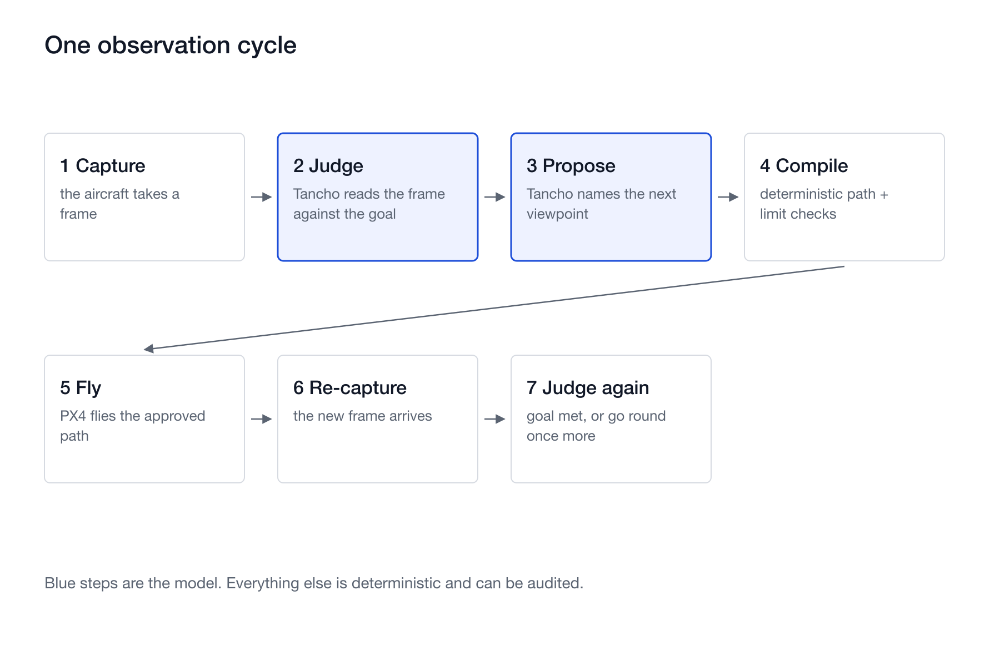

# Tancho: the drone decides where to look next

An on-board model that reads a disaster scene, names the view that is still missing, and
flies the drone there. The model is a fine-tune of **NVIDIA Cosmos 3 Edge**; training and
the frozen evaluation run on **Nebius AI Cloud**, and the ground-side tasking step runs on
**Nebius Token Factory** with **NVIDIA Nemotron**.

Open weights: [`v13s/tancho`](https://huggingface.co/v13s/tancho), revision
`1d2b42a3e00542a63bbaf216295c7d119c706b2b` (2.44B parameters, BF16).

Demo video (3 minutes): https://youtu.be/3Kl3QwWzflA

## The loop



1. The aircraft captures a frame.
2. **Reasoner** (Cosmos 3 Edge fine-tune) reads it against the observation goal and reports
   whether the goal is met, or what is missing.
3. The **viewpoint readout** proposes the next viewpoint as a direction and a distance,
   inside a volume approved before takeoff.
4. A **deterministic compiler** turns that viewpoint into a flight path and checks it
   against the approved volume, the altitude ceiling, obstacle clearance, dwell time and
   the pixels required on the target. A proposal that breaks a limit is rejected before the
   aircraft moves.
5. The aircraft flies, captures again, and the Reasoner judges the new frame.

Nothing outside step 2 and 3 is produced by a language model. Detection, geometry and limit
checking are deterministic, so they can be audited.

## Where NVIDIA and Nebius are used

| Step | What runs | Where |
|---|---|---|
| Parent model | NVIDIA Cosmos 3 Edge, through NVIDIA `cosmos-framework` | - |
| Training, frozen evaluation | the fine-tune and its 104-case evaluation | **Nebius AI Cloud Serverless Jobs**, `gpu-h100-sxm` `1gpu-16vcpu-200gb`, image pinned by digest in Nebius Container Registry, parent weights on a Nebius compute filesystem |
| Tasking to observation goal | **NVIDIA Nemotron 3.5 Lightning** | **Nebius Token Factory** |
| On-board inference | the published fine-tune | Jetson-class board (measurement pending) |

## Install

```bash
git clone <this repository> && cd tancho-nebius
uv venv && uv pip install torch transformers pillow
```

The evaluation also needs NVIDIA `cosmos-framework` at revision
`96303bb0bdd14d9efa18f24d8ef98c7a0bfb8412`, which supplies the Cosmos 3 Edge model class and
processor:

```bash
git clone https://github.com/NVIDIA/cosmos-framework.git
git -C cosmos-framework checkout 96303bb0bdd14d9efa18f24d8ef98c7a0bfb8412
uv sync --frozen --all-extras --group=cu130-train --directory cosmos-framework
```

## Run the ground-side tasking step (Nebius Token Factory)

Put a Token Factory API key in `~/.config/tancho/token_factory_api_key` (mode 600) or in
`NEBIUS_TOKEN_FACTORY_API_KEY`. Never pass a key as a command-line argument.

```bash
python3 tools/demo_tasking.py
```

That is the step shown in the demo video: two taskings, each turned into one observation goal
and checked against the catalog. One call on its own is three lines:

```bash
python3 -c "
from tancho.tasking_to_goal import request, parse_goal, validate_goal
r = request('Check whether the road under the slope is still passable.',
            'nvidia/Nemotron-3_5-Lightning')
goal = parse_goal(r['raw']); print(goal, validate_goal(goal))"
```

The model may only choose from the closed vocabulary of the mission profile catalog in
`tancho/mission_profiles.py`; `validate_goal` returns every violation, and a goal with any
violation never reaches the aircraft.

### Reproduce the model comparison

```bash
python3 training/evaluate_tasking_models.py \
  --model nvidia/Nemotron-3_5-Lightning \
  --model nvidia/NVIDIA-Nemotron-3-Nano-30B-A3B \
  --model nvidia/nemotron-3-super-120b-a12b
```

The 16 cases in `training/tasking-goal-cases-v1.json` were frozen before any model was
called. Results are in `docs/nemotron-tasking-comparison.md`.

## Run the frozen evaluation on Nebius AI Cloud

`deploy/nebius_exhibition/prepare_evaluation_job.py` creates a Serverless Job that downloads
the published revision, clones the pinned `cosmos-framework`, clones this repository at the
commit it pins and checks the frozen pack's manifest hash, then evaluates all 104 cases on one
H100. It validates with `--dry-run` by default and only creates a job with `--execute`.

Three things come from your own Nebius account, so the script reads them from the environment
rather than carrying ours:

```bash
export NEBIUS_PROJECT_ID=project-...          # the project the job is created in
export NEBIUS_FILESYSTEM_ID=computefilesystem-...  # holds the Cosmos 3 Edge parent weights
export NEBIUS_IMAGE_REF=cr.<region>.nebius.cloud/<registry>/<image>@sha256:...

python3 deploy/nebius_exhibition/prepare_evaluation_job.py            # dry run
python3 deploy/nebius_exhibition/prepare_evaluation_job.py --execute  # creates the job
```

The job prints one `TANCHO_EVAL` line with the score. Our run scored 104 of 104, with
`exact_accuracy` 1.0 and `schema_valid_rate` 1.0, in 313 seconds.

## Before you publish anything from this tree

```bash
python3 tools/scan_public.py .
```

It fails on client names, cloud resource ids, local absolute paths and credentials.

## License

MIT for this code. The published weights are a derivative of NVIDIA Cosmos 3 Edge and carry
the parent model's license; see the model card at `v13s/tancho`.
